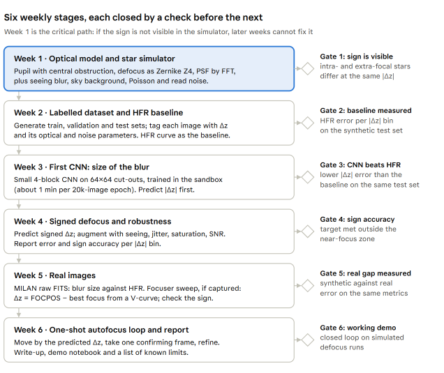

# Single-Image Telescope Autofocus

**EOI Deep Learning** project repository (6-week course track, 18 h of live sessions): estimating a telescope's **signed focus error** ($\Delta z = p - p^*$) from a single `64×64` grayscale star cut-out using a compact CNN trained on physically simulated star images.

Instead of running a multi-frame V-curve sweep to find best focus, the model predicts both **how far** to move the focuser ($|\Delta z|$) and **in which direction** ($\operatorname{sign}(\Delta z)$: inside vs. outside focus) from one frame.

> **Provenance:** These materials were produced in an external Claude session ([`claude.txt`](claude.txt): [claude.ai/chat/34b3689f-422c-4f62-bfbc-76436a93de3d](https://claude.ai/chat/34b3689f-422c-4f62-bfbc-76436a93de3d), 2026-11-18, 10:14–11:22 Europe/Madrid) and distilled into a 7-phase, 12-prompt procedural log in [`WORKFLOW_PROCEDURE.md`](WORKFLOW_PROCEDURE.md).

---

## Key Insights Distilled from the Materials

1. **Training must be synthetic — no public dataset carries signed focus labels** ([Phase 1](WORKFLOW_PROCEDURE.md#phase-1-data-source-survey): [P-01](WORKFLOW_PROCEDURE.md#prompt-p-01); [Phase 2](WORKFLOW_PROCEDURE.md#phase-2-sandbox-capability--labelling-requirement): [P-03](WORKFLOW_PROCEDURE.md#prompt-p-03)).
   Twelve web and Kaggle searches (including *Mapping Dark Matter*, *Blur Dataset*, *SpaceNet*, and *NASA APOD*) turned up no astronomical dataset tagged with signed focus error. Consequently, the project separates data roles strictly:

   - **Training / validation / controlled test:** physical simulator with exact ground-truth $\Delta z$.
   - **Real unlabeled test (blur size only):** [MILAN Sky Survey](https://zenodo.org/records/7304607) raw Stellina FITS frames on Zenodo (validated via correlation with classical HFR).
   - **Real signed test (pending capture):** own FITS focuser sweep captured with NINA, Ekos, or ASCOM, where $\Delta z = \texttt{FOCPOS} - p^*$ from a V-curve fit.
   - **Optional parallel benchmark:** [BBBC006](https://bbbc.broadinstitute.org/BBBC006) microscopy z-stack ($z = 16$ in focus, $2\,\mu\text{m}$ steps).
2. **Sign observability is the critical path and requires optical asymmetry** ([Phase 3](WORKFLOW_PROCEDURE.md#phase-3-problem-statement--plan): [P-04](WORKFLOW_PROCEDURE.md#prompt-p-04); [Phase 6](WORKFLOW_PROCEDURE.md#phase-6-physical-simulator-calibrated-on-a-real-frame): [P-10](WORKFLOW_PROCEDURE.md#prompt-p-10)–[P-11](WORKFLOW_PROCEDURE.md#prompt-p-11)).
   Pure symmetric defocus produces identical point-spread functions (PSFs) on both sides of focus, making $\operatorname{sign}(\Delta z)$ impossible to learn. Breaking intra-/extra-focal symmetry via real optical imperfections—specifically **spherical aberration** (`0.4 waves` in `Z11`), central obstruction, or deliberate astigmatism—is mandatory. In the physical simulator, spherical aberration makes intra-focal (`dz < 0`) stars form crisp rings with a deeper central hole, while extra-focal (`dz > 0`) stars form softer, more centrally filled profiles.
3. **Closing the toy-to-physical domain gap (`Benchmark v0/` → `Fourier-optics simulator/` Dataset v1)** ([Phase 6](WORKFLOW_PROCEDURE.md#phase-6-physical-simulator-calibrated-on-a-real-frame): [P-10](WORKFLOW_PROCEDURE.md#prompt-p-10) real-frame analysis & [P-11](WORKFLOW_PROCEDURE.md#prompt-p-11) simulator build).
   Benchmarking the initial toy ring generator against an actual raw telescope frame revealed six major gaps: an artificial width-based sign shortcut, unmottled smooth rings, unrealistically high SNR vs. the real frame (`ring SNR ≈ 6.5`), perfectly centered stars without jitter, missing Moffat seeing wings, and missing ADU/bias/read-noise sensor physics.
   Replacing the toy generator with a Fourier-optics pipeline (`|FFT(pupil)|²` + Kolmogorov turbulence screens + Moffat seeing + Poisson/read/bias sensor model) and fitting it to the real frame's radial profile (ring peak at `r = 14 px`, half-max from `5` to `23 px`, central hole at `42%` of peak) matched the observed profile with **RMS error `0.04`** at `W = 9 waves`, seeing FWHM `10 px`, Moffat $\beta = 4$, and $D/r_0 = 6$.
4. **CPU-only sandbox constraints dictate input size, architecture, and sharding** ([Phase 2](WORKFLOW_PROCEDURE.md#phase-2-sandbox-capability--labelling-requirement): [P-02](WORKFLOW_PROCEDURE.md#prompt-p-02); [Phase 6](WORKFLOW_PROCEDURE.md#phase-6-physical-simulator-calibrated-on-a-real-frame): [P-11](WORKFLOW_PROCEDURE.md#prompt-p-11)).
   Benchmarked on 2 Intel Xeon CPU cores (2.1 GHz, AVX-512/AMX), 7.8 GB RAM, no GPU, PyTorch 2.15 (CPU), and a ~10-minute working-turn ceiling:

   - `64×64` cut-outs train at `~340 images/s` (`~1 min` per 20k-image epoch), whereas `128×128` drops to `~60 images/s` (`~5.5 min/epoch`). Cut-outs are therefore capped at `64×64` (`≤ 96×96`) with a lightweight 4-block CNN.
   - Generating 20,000 physical images takes `398 s` (~6.6 min) and is split into 10 resumable shards of 2,000 images (`shards/shard_XX.npz`, seed `1000 + k`) so long runs survive execution limits.
5. **Baseline CNN validation confirms the sign is learnable away from best focus** ([Phase 6](WORKFLOW_PROCEDURE.md#phase-6-physical-simulator-calibrated-on-a-real-frame): [P-11](WORKFLOW_PROCEDURE.md#prompt-p-11)).
   A 4-block CNN ([`Fourier-optics simulator/train_check_v1.py`](<Fourier-optics%20simulator/train_check_v1.py>), L1 loss, 4-px border median/std normalization) trained on Dataset v1 (`Fourier-optics simulator/defocus_stars_v1.npz`) for 4 epochs (`183 s` on 2 CPU cores) achieved **`148 µm` test MAE** and **`88.9%` overall sign accuracy**:

   | $\lvert \Delta z \rvert$ bin (`µm`) | Sign accuracy | Interpretation                                                                 |
   | ---------------------------------------- | ------------- | ------------------------------------------------------------------------------ |
   | `0 – 200`                             | `58%`       | Near-focus zone (blur changes minimally; small corrective moves matter little) |
   | `200 – 400`                           | `90%`       | Transition zone                                                                |
   | `400 – 800`                           | `95%`       | Meets proposed `≥ 95%` sign accuracy target                                 |
   | `> 800`                                | `98%`       | Reliable directional prediction far from focus                                 |

---

## Visual Verification (`Fourier-optics simulator/` — Physical Dataset v1)

Generated in [Phase 6](WORKFLOW_PROCEDURE.md#phase-6-physical-simulator-calibrated-on-a-real-frame) ([P-10](WORKFLOW_PROCEDURE.md#prompt-p-10)–[P-11](WORKFLOW_PROCEDURE.md#prompt-p-11)) when calibrating the Fourier-optics simulator against a real raw telescope frame.

### Physical Simulator Calibration vs. Real Frame

Comparing the real raw frame (extracted from a screenshot) against three random synthetic ADU realizations, placeholder preprocessing, radial profile fit, and the noise-free intra-/extra-focal sign cue (`W = -9` vs. `W = +9` waves):


### Synthetic Raw ADU Samples Across Defocus (`-1200 µm` to `+1200 µm`)

Top row: inside focus (`dz < 0`, sharper ring outer edge, deeper hole). Bottom row: outside focus (`dz > 0`, softer, more centrally filled ring):


---

## Repository Layout

> [!IMPORTANT]
> **Two Dataset Directories by Purpose:**
>
> - [`Benchmark v0/`](<Benchmark%20v0/README.md>) → non-physical Gaussian-ring toy benchmark (`toy_defocus_stars_v0.npz`) created for CPU timing and smoke tests ([Phase 2](WORKFLOW_PROCEDURE.md#phase-2-sandbox-capability--labelling-requirement) [`P-02`](WORKFLOW_PROCEDURE.md#prompt-p-02) & [Phase 4](WORKFLOW_PROCEDURE.md#phase-4-toy-dataset-documentation--release) [`P-05`](WORKFLOW_PROCEDURE.md#prompt-p-05)–[`P-07`](WORKFLOW_PROCEDURE.md#prompt-p-07), [`P-09`](WORKFLOW_PROCEDURE.md#prompt-p-09)).
> - [`Fourier-optics simulator/`](<Fourier-optics%20simulator/README_v1.md>) → calibrated physical Fourier-optics simulator (`star_sim.py`) and Dataset v1 (`defocus_stars_v1.npz`) ([Phase 6](WORKFLOW_PROCEDURE.md#phase-6-physical-simulator-calibrated-on-a-real-frame) [`P-10`](WORKFLOW_PROCEDURE.md#prompt-p-10)–[`P-11`](WORKFLOW_PROCEDURE.md#prompt-p-11)).

```text
77-EOI-26Q4-Telescope-Autofocus/
├── README.md                                                     # This overview
├── claude.txt                                                    # External Claude conversation URL
├── WORKFLOW_PROCEDURE.md                                         # 7-phase, 12-prompt workflow & traceability matrix
├── Single-Image Telescope Autofocus — Problem Statement & Plan.md    # Problem definition, metrics, 6-week plan (.md)
├── Single-Image Telescope Autofocus — Problem Statement & Plan.pdf   # Exported PDF version
├── Single-Image Telescope Autofocus — Problem Statement & Plan.docx  # Exported Word version
├── Dataset Card — Toy Defocused-Star Set (benchmark v0).md       # Formal dataset card for Benchmark v0
├── docs/
│   └── STUDENT_WEEK1_GUIDE.md                                    # 7-day student self-study guide (Week 1 → Week 2)
├── image/
│   └── Single-ImageTelescopeAutofocus—ProblemStatement&Plan/
│       └── 1794995707971.png                                     # 6-week gated roadmap diagram
├── Benchmark v0/                                                 # Non-physical toy set (CPU timing & smoke tests)
│   ├── README.md                                                 # Benchmark v0 schema & load snippet
│   ├── make_toy_defocus_stars.py                                 # Deterministic seed-0 generator
│   ├── plot_toy_samples.py                                       # 2×6 sample grid plotter
│   └── toy_defocus_stars_v0.npz                                  # 20,000 × 64×64 uint16 counts (60 MB)
└── Fourier-optics simulator/                                     # Physical Fourier-optics simulator & Dataset v1
    ├── README_v1.md                                              # Dataset v1 optical config, schema & limits
    ├── star_sim.py                                               # Fourier-optics simulator & placeholder preprocess()
    ├── make_dataset_v1.py                                        # Sharded 20k-image dataset builder
    ├── plot_samples_v1.py                                        # 2×6 ADU grid plotter
    ├── hfr_baseline.py                                           # Half-flux-radius baseline for |dz| (numpy only)
    ├── cnn_vs_hfr.py                                             # CNN against HFR on |dz| (torch, GPU if available)
    ├── signed_robustness.py                                      # Signed CNN: sign accuracy and robustness (torch)
    ├── train_check_v1.py                                         # 4-epoch 4-block CNN sanity check
    ├── defocus_stars_v1.npz                                      # 20,000 × 64×64 uint16 ADU + metadata (109 MB)
    ├── samples_v1.png                                            # Rendered 2×6 grid across dz
    └── sim_vs_real_v1.png                                        # Real-frame calibration & sign-cue comparison
```

**Core Documents:**

- [Student Self-Study Guide (Week 1 → Week 2)](docs/STUDENT_WEEK1_GUIDE.md)
- [Problem Statement &amp; Plan (Markdown)](<Single-Image%20Telescope%20Autofocus%20—%20Problem%20Statement%20&%20Plan.md>) · [PDF](<Single-Image%20Telescope%20Autofocus%20—%20Problem%20Statement%20&%20Plan.pdf>) · [DOCX](<Single-Image%20Telescope%20Autofocus%20—%20Problem%20Statement%20&%20Plan.docx>)
- [Dataset Card — Toy Defocused-Star Set (benchmark v0)](<Dataset%20Card%20—%20Toy%20Defocused-Star%20Set%20%28benchmark%20v0%29.md>)
- [Workflow Procedure &amp; Prompt Catalog](WORKFLOW_PROCEDURE.md)

*(Note: Intermediate Claude sandbox files mentioned in `WORKFLOW_PROCEDURE.md` — `bench.py`, `fit_profile.py`, `real_frame_grey64.npy`, `toy_samples_v0.png`, `gen_v1.log`, and `train_v1.log` — remained in the ephemeral sandbox and are not stored in this repo; `toy_samples_v0.png` can be regenerated with `Benchmark v0/plot_toy_samples.py`.)*

---

## `Benchmark v0/` vs. `Fourier-optics simulator/` — What Is the Difference?

In short: **`Benchmark v0/`** is a non-physical toy benchmark built only to time CPU training and check the training loop, whereas **`Fourier-optics simulator/`** contains the physical Fourier-optics simulator (`star_sim.py`) and its generated **Dataset v1** (`defocus_stars_v1.npz`) calibrated against a real telescope frame.

> [!WARNING]
> **Do not train or evaluate the autofocus model on [`Benchmark v0/toy_defocus_stars_v0.npz`](<Benchmark%20v0/README.md>).** Its sign accuracy (`98.2%` in 3 epochs) relies on an invented ring-width rule (`w = 1.5 + 0.5·d`), not physical optics. Use it strictly for training-loop smoke tests and CPU timing.

| Property                        | `Benchmark v0/` (Toy Benchmark)                                                                                                                                                                                                                                                                                                        | `Fourier-optics simulator/` (Physical Dataset v1)                                                                                                                                                                     |
| ------------------------------- | ---------------------------------------------------------------------------------------------------------------------------------------------------------------------------------------------------------------------------------------------------------------------------------------------------------------------------------------- | ----------------------------------------------------------------------------------------------------------------------------------------------------------------------------------------------------------------------- |
| **Purpose**               | CPU throughput & training-loop smoke test only                                                                                                                                                                                                                                                                                           | First realistic physical training/validation dataset                                                                                                                                                                    |
| **Archive & size**        | `toy_defocus_stars_v0.npz` (~60 MB)                                                                                                                                                                                                                                                                                                    | `defocus_stars_v1.npz` (~109 MB)                                                                                                                                                                                      |
| **Image tensor**          | `counts`: `(20000, 1, 64, 64)`, `uint16` (`scale = 200.0`)                                                                                                                                                                                                                                                                       | `adu`: `(20000, 64, 64)`, `uint16` (includes `100 ADU` bias)                                                                                                                                                    |
| **Target label**          | `d`: normalized `[-1, 1]` (`float32`, no physical unit)                                                                                                                                                                                                                                                                            | `dz_um`: `[-1210, +1210] µm`; `defocus_waves`: `[-11, +11]`                                                                                                                                                    |
| **Physics / optics**      | None (Gaussian ring `R = 2 + 12\|d\|` + Poisson noise)                                                                                                                                                                                                                                                                                   | `\|FFT(pupil)\|²`, 30% obstruction, Kolmogorov screens, Moffat seeing, ADU noise                                                                                                                                       |
| **Sign mechanism**        | Invented shortcut (`w = 1.5 + 0.5·d`)                                                                                                                                                                                                                                                                                                 | `0.4 waves` spherical aberration (`Z11`)                                                                                                                                                                            |
| **Per-image metadata**    | None                                                                                                                                                                                                                                                                                                                                     | 13 parameter arrays (`seeing_fwhm_px`, `moffat_beta`, `d_over_r0`, `shift_x/y_px`, `sky_e`, `read_noise_e`, `ring_snr`, `flux_e`, `astig0/45_waves`, `comax/y_waves`) + JSON `config`             |
| **Splits**                | `train_idx` `18,000` / `test_idx` `2,000`                                                                                                                                                                                                                                                                                        | `train_idx` `16,000` / `val_idx` `2,000` / `test_idx` `2,000`                                                                                                                                               |
| **Baseline CNN check**    | `MAE 0.012`, `98.2%` sign (3 epochs, `172 s` — shortcut)                                                                                                                                                                                                                                                                          | `MAE 148 µm`, `88.9%` overall sign; `95–98%` for `\|dz\| > 400 µm` (4 epochs, `183 s`)                                                                                                                       |
| **Claude session origin** | [Phase 2](WORKFLOW_PROCEDURE.md#phase-2-sandbox-capability--labelling-requirement) ([P-02](WORKFLOW_PROCEDURE.md#prompt-p-02)) & [Phase 4](WORKFLOW_PROCEDURE.md#phase-4-toy-dataset-documentation--release) ([P-05](WORKFLOW_PROCEDURE.md#prompt-p-05)–[P-07](WORKFLOW_PROCEDURE.md#prompt-p-07), [P-09](WORKFLOW_PROCEDURE.md#prompt-p-09)) | [Phase 6](WORKFLOW_PROCEDURE.md#phase-6-physical-simulator-calibrated-on-a-real-frame) ([P-10](WORKFLOW_PROCEDURE.md#prompt-p-10) real-frame comparison & [P-11](WORKFLOW_PROCEDURE.md#prompt-p-11) simulator + 20k build) |

### Assumed Optical & Noise Parameters (`Fourier-optics simulator/` — Dataset v1)

Configured in `Telescope` and `Ranges` inside [`Fourier-optics simulator/star_sim.py`](<Fourier-optics%20simulator/star_sim.py>) as typical placeholder hardware until the student's real setup is specified:

- **Optics:** `200 mm` aperture, `1000 mm` focal length (`f/5`), `30%` central obstruction, `0` spider vanes, `λ = 0.55 µm`, `3.76 µm` pixel (`1.37 λ/D` per pixel), `dz = 110 µm/wave` ($8 N^2 \lambda$), `0.4 waves` fixed spherical aberration (`Z11`), random astigmatism/coma (`0.15 waves RMS` each).
- **Atmosphere & framing:** Kolmogorov phase screen (`D/r0` in `2.0–5.0`), Moffat seeing (`FWHM 6–12 px`, `β 2.5–4.5`), Fourier-tilt sub-pixel center jitter (`±3.0 px`).
- **Sensor & signal:** Sky `50–800 e⁻/px`, ring SNR `3.0–12.0`, read noise `3.0–10.0 e⁻`, gain `1.0 e⁻/ADU`, bias `100.0 ADU`, `65,535 ADU` ceiling.

### Loading the Physical Dataset (`Fourier-optics simulator/defocus_stars_v1.npz`) in Python

```python
import json
import numpy as np

z = np.load("Fourier-optics simulator/defocus_stars_v1.npz")
X = z["adu"].astype(np.float32)       # (20000, 64, 64), raw ADU (100 ADU bias)
dz = z["dz_um"]                       # (20000,), signed focus error in µm
cfg = json.loads(str(z["config"]))    # telescope, ranges, and seed configuration

X_train, dz_train = X[z["train_idx"]], dz[z["train_idx"]]
X_val,   dz_val   = X[z["val_idx"]],   dz[z["val_idx"]]
X_test,  dz_test  = X[z["test_idx"]],  dz[z["test_idx"]]
```

---

## Quick Start & Reproduction

**Dependencies:** `numpy`, `torch`, `matplotlib` (plus `astropy` and `poppy` if extending toward FITS files and optical verification).

Run commands from inside each directory so relative imports (`star_sim`) and default output filenames resolve cleanly:

```bash
# 1. Fourier-optics simulator/ — Physical Dataset v1 pipeline
cd "Fourier-optics simulator"
python hfr_baseline.py defocus_stars_v1.npz            # classical |dz| baseline (numpy only)
python cnn_vs_hfr.py defocus_stars_v1.npz 40 3         # CNN vs HFR (about 8 min on an RTX 2060)
python signed_robustness.py defocus_stars_v1.npz       # signed CNN to convergence (about 10 min on an RTX 2060)
python train_check_v1.py defocus_stars_v1.npz 4        # 4-epoch CNN sanity check (~3 min on 2 CPUs)
python plot_samples_v1.py defocus_stars_v1.npz samples_v1.png
python make_dataset_v1.py 20000 defocus_stars_v1.npz   # sharded rebuild (~7 min on 2 CPUs)
```

```bash
# 2. Benchmark v0/ — Non-physical toy throughput placeholder only
cd "Benchmark v0"
python make_toy_defocus_stars.py                       # rebuilds toy_defocus_stars_v0.npz (seed 0)
python plot_toy_samples.py toy_defocus_stars_v0.npz toy_samples_v0.png
```

To adapt the simulator to a real telescope, edit `Telescope` and `Ranges` in [`Fourier-optics simulator/star_sim.py`](<Fourier-optics%20simulator/star_sim.py>), and replace the placeholder `preprocess()` function so the exact same preprocessing is applied to both synthetic and real frames.

---

## 6-Week Gated Roadmap & Success Criteria

Each weekly stage ends at a gate that must pass before moving forward (falling back to the risk mitigations in the [Problem Statement &amp; Plan](<Single-Image%20Telescope%20Autofocus%20—%20Problem%20Statement%20&%20Plan.md>) if a gate fails):



| Week        | Stage                                             | Gate                                                                         | Repo Status                                                                       |
| ----------- | ------------------------------------------------- | ---------------------------------------------------------------------------- | --------------------------------------------------------------------------------- |
| **1** | Optical model & star simulator                    | Sign is visible (intra vs. extra differ at equal $\lvert \Delta z \rvert$) | **Prototype done** (`star_sim.py` with assumed 200 mm f/5 & 0.4 waves SA) |
| **2** | Labelled dataset & HFR baseline                   | HFR error measured per $\lvert \Delta z \rvert$ bin on synthetic test set  | **Done:** Dataset v1; HFR baseline `64.9 µm` MAE of `\|dz\|` (test)      |
| **3** | First CNN: blur size ($\lvert \Delta z \rvert$) | Small 4-block CNN beats HFR baseline on same test set                        | **Done:** CNN `46.6 µm` vs HFR `64.9 µm` on `\|dz\|` ([report 05](REPORTS/05-cnn-blur-size.md)) |
| **4** | Signed defocus & robustness                       | Sign target met outside near-focus zone across seeing/jitter/SNR             | **Done (simulation):** sign `98.2%` for `\|dz\| ≥ 200 µm` ([report 06](REPORTS/06-signed-defocus-robustness.md)) |
| **5** | Real images (MILAN + focuser sweep)               | Real-vs-synthetic error gap measured on same metrics                         | **Pending** (calibrated visually on 1 screenshot so far)                    |
| **6** | One-shot autofocus loop & report                  | Closed loop reaches focus on simulated defocus runs                          | **Pending**                                                                 |

### Success Metrics

| Metric                              | Measured On                                                                   | Target                         |
| ----------------------------------- | ----------------------------------------------------------------------------- | ------------------------------ |
| Mean absolute error of $\Delta z$ | Synthetic test set, per $\lvert \Delta z \rvert$ bin (depth-of-focus units) | Beats HFR baseline             |
| Sign accuracy                       | Synthetic test set, outside near-focus zone                                   | Proposed: `≥ 95%`           |
| Sign accuracy                       | Real focuser sweep (if captured)                                              | Reported (no fixed target yet) |
| Blur size vs. HFR                   | MILAN real FITS frames                                                        | Reported as correlation        |
| Moves to reach focus                | Simulated closed-loop autofocus runs                                          | Proposed: `1–2 moves`       |

---

## Known Limitations & Open Decisions

### Known Simulator Limits (`Fourier-optics simulator/` — Dataset v1)

Documented in [`Fourier-optics simulator/README_v1.md`](<Fourier-optics%20simulator/README_v1.md>) and [Phase 6](WORKFLOW_PROCEDURE.md#phase-6-physical-simulator-calibrated-on-a-real-frame):

- **Single-screenshot calibration:** Parameters were fit to grayscale values read from one screenshot rather than true raw 16-bit FITS ADU frames.
- **Assumed spherical aberration:** The `0.4 waves` (`Z11`) asymmetry is an estimate; real sign magnitude must be measured from an actual intra-/extra-focal focuser sweep.
- **Simplified imaging physics:** Monochromatic (`0.55 µm`) with no chromatic smearing, no spider vanes by default (`spider_vanes = 0`), no saturation (`flux` is SNR-scaled below `65,535`), and no hot pixels, cosmic rays, sky gradients, or neighboring stars.
- **Placeholder preprocessing:** `preprocess()` in [`Fourier-optics simulator/star_sim.py`](<Fourier-optics%20simulator/star_sim.py>) uses MAD + `99.5`th percentile clipping as a stand-in for the real `"preprocesada"` routine.

### Open Decisions (Before Locking Week 1)

- [ ] Confirm real telescope & camera specs (aperture, focal ratio, obstruction ratio, spider vanes, pixel size, gain, bias).
- [ ] Lock down the canonical unit for $\Delta z$ (focuser steps, `µm` at focal plane, or waves of defocus / depth-of-focus units).
- [ ] Agree on final numerical targets for MAE, sign accuracy, and closed-loop autofocus moves.
- [ ] Capture a real FITS focuser sweep (`FOCPOS` header) to measure true spherical aberration and validate real-sky sign accuracy.
- [ ] Replace placeholder `preprocess()` in [`Fourier-optics simulator/star_sim.py`](<Fourier-optics%20simulator/star_sim.py>) with the real preprocessing step and re-calibrate on raw FITS frames.

---

## Process Provenance

All artifacts were generated in an external Claude conversation ([`claude.txt`](claude.txt): [claude.ai/chat/34b3689f-422c-4f62-bfbc-76436a93de3d](https://claude.ai/chat/34b3689f-422c-4f62-bfbc-76436a93de3d), 2026-11-18, 10:14–11:22 Europe/Madrid) and distilled in [`WORKFLOW_PROCEDURE.md`](WORKFLOW_PROCEDURE.md), which records the [Chronological Prompt Index](WORKFLOW_PROCEDURE.md#a1-chronological-prompt-index), verbatim prompts [`P-01`–`P-12`](WORKFLOW_PROCEDURE.md#a2-exhaustive-verbatim-prompt-catalog), and full [Traceability Matrix](WORKFLOW_PROCEDURE.md#a3-comprehensive-traceability-matrix-prompt--phase--artifacts--commits):

| Phase                                                                                           | Focus Area                                                                  | Claude Prompts                                                                                                                                                         | Primary Outcome / Artifacts                                                                                                                                                                        |
| ----------------------------------------------------------------------------------------------- | --------------------------------------------------------------------------- | ---------------------------------------------------------------------------------------------------------------------------------------------------------------------- | -------------------------------------------------------------------------------------------------------------------------------------------------------------------------------------------------- |
| **[Phase 1](WORKFLOW_PROCEDURE.md#phase-1-data-source-survey)**                            | Data source survey                                                          | [P-01](WORKFLOW_PROCEDURE.md#prompt-p-01)                                                                                                                               | Confirmed no Kaggle dataset carries signed focus labels; defined synthetic-train / real-test split                                                                                                 |
| **[Phase 2](WORKFLOW_PROCEDURE.md#phase-2-sandbox-capability--labelling-requirement)**     | Sandbox capability & labelling                                              | [P-02](WORKFLOW_PROCEDURE.md#prompt-p-02), [P-03](WORKFLOW_PROCEDURE.md#prompt-p-03)                                                                                     | Benchmarked 2-CPU PyTorch (`64×64` at `~340 img/s` via `bench.py`); defined `Δz = FOCPOS − p*` sweep labelling                                                                          |
| **[Phase 3](WORKFLOW_PROCEDURE.md#phase-3-problem-statement--plan)**                       | Problem statement & plan                                                    | [P-04](WORKFLOW_PROCEDURE.md#prompt-p-04)                                                                                                                               | Authored 6-section problem spec & 6-week gated roadmap                                                                                                                                             |
| **[Phase 4](WORKFLOW_PROCEDURE.md#phase-4-toy-dataset-documentation--release)**            | Toy dataset release (`Benchmark v0/`)                                     | [P-05](WORKFLOW_PROCEDURE.md#prompt-p-05), [P-06](WORKFLOW_PROCEDURE.md#prompt-p-06), [P-07](WORKFLOW_PROCEDURE.md#prompt-p-07), [P-09](WORKFLOW_PROCEDURE.md#prompt-p-09) | Released [`Benchmark v0/`](<Benchmark%20v0/README.md>) (`toy_defocus_stars_v0.npz`) & formal Dataset Card                                                                                       |
| **[Phase 5](WORKFLOW_PROCEDURE.md#phase-5-plan-feasibility-check)**                        | Plan feasibility check                                                      | [P-08](WORKFLOW_PROCEDURE.md#prompt-p-08)                                                                                                                               | Verified Zenodo/BBBC network access, installed `astropy` & `poppy`, mapped runnable weeks                                                                                                      |
| **[Phase 6](WORKFLOW_PROCEDURE.md#phase-6-physical-simulator-calibrated-on-a-real-frame)** | Calibrated physical simulator (`Fourier-optics simulator/` → Dataset v1) | [P-10](WORKFLOW_PROCEDURE.md#prompt-p-10), [P-11](WORKFLOW_PROCEDURE.md#prompt-p-11)                                                                                     | Built [`Fourier-optics simulator/star_sim.py`](<Fourier-optics%20simulator/star_sim.py>), fit real frame (`RMS 0.04`), generated 20k sharded ADU images, ran 4-epoch CNN check (`88.9%` sign) |
| **[Phase 7](WORKFLOW_PROCEDURE.md#phase-7-process-distillation)**                          | Process distillation                                                        | [P-12](WORKFLOW_PROCEDURE.md#prompt-p-12)                                                                                                                               | Compiled [`WORKFLOW_PROCEDURE.md`](WORKFLOW_PROCEDURE.md)                                                                                                                                         |
