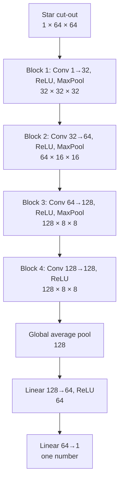
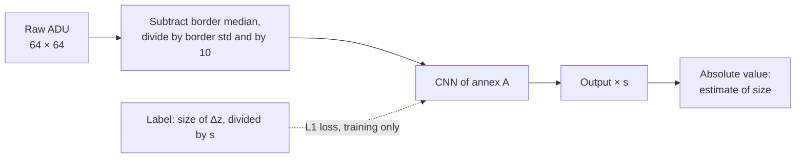
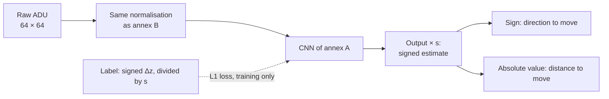
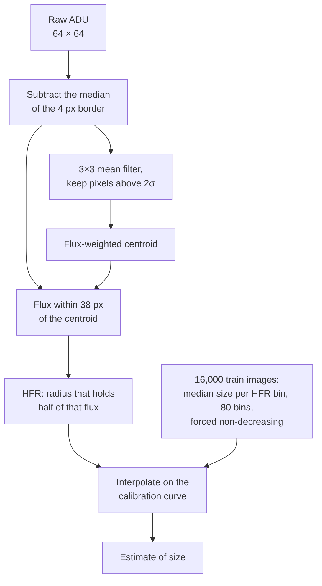

# 05 · CNN against HFR on blur size (week 3)

Run and written 2026-11-27.

## Objective and gate

Estimate |Δz| with a small CNN. **Gate:** the 4-block CNN beats the HFR baseline (report [04](04-hfr-baseline.md)) on the same test split.

## Method

- [`cnn_vs_hfr.py`](../Fourier-optics%20simulator/cnn_vs_hfr.py), conda env `xgnn` (PyTorch 2.5.1, CUDA, RTX 2060).
- Command: `python cnn_vs_hfr.py defocus_stars_v1.npz 40 3` (and `4 3` for the short run).
- Network, normalisation and optimiser as in `train_check_v1.py`: 4 convolution blocks, L1 loss, Adam 1e-3, batch 128.
- Two training targets: **size** (trained on |Δz|) and **signed** (trained on Δz, scored on |prediction|).
- Train 16,000 images; the epoch with the lowest error on the 2,000 validation images is kept; test 2,000 images.
- Three seeds each. Confidence intervals: paired bootstrap over test images, 10,000 resamples.

### Network architecture

Defined in `make_net()` of [`cnn_vs_hfr.py`](../Fourier-optics%20simulator/cnn_vs_hfr.py). Both targets use the same network. All convolutions are 3×3 with padding 1 and stride 1.

| Stage | Layers | Output (channels × height × width) | Parameters |
|---|---|---|---|
| Input | normalised star cut-out | 1 × 64 × 64 | 0 |
| Block 1 | Conv 1→32, ReLU, MaxPool 2×2 | 32 × 32 × 32 | 320 |
| Block 2 | Conv 32→64, ReLU, MaxPool 2×2 | 64 × 16 × 16 | 18,496 |
| Block 3 | Conv 64→128, ReLU, MaxPool 2×2 | 128 × 8 × 8 | 73,856 |
| Block 4 | Conv 128→128, ReLU, global average pool | 128 × 1 × 1 | 147,584 |
| Head 1 | Flatten, Linear 128→64, ReLU | 64 | 8,256 |
| Head 2 | Linear 64→1 | 1 | 65 |
| **Total** | | | **248,577** |

- **No** batch normalisation, dropout or output activation.
- **Input:** (ADU − border median) / (border standard deviation) / 10, with a 4 px border.
- **Output:** one number, multiplied by the largest |Δz| in the dataset (about 1,210 µm) to give µm. The training target is divided by the same value.

## RESULTS

### 40 epochs (about 80 s per training)

MAE of |Δz| in µm on the test split; CNN values are the mean of three seeds.

| \|Δz\| (µm) | n | HFR | CNN signed | CNN size |
|---|---|---|---|---|
| 0–200 | 357 | 83.5 | 64.6 | 60.3 |
| 200–400 | 308 | 77.3 | 70.0 | 54.1 |
| 400–800 | 664 | 64.5 | 52.6 | 41.4 |
| 800–1200 | 657 | 49.1 | 56.6 | 41.0 |
| 1200–1600 | 14 | 75.3 | 40.6 | 43.4 |
| **All** | 2000 | **64.9** | **58.7** | **46.6** |

| Improvement over HFR | µm | 95% CI |
|---|---|---|
| CNN size | 18.3 | 16.4 to 20.2 |
| CNN signed | 6.2 | 2.7 to 9.6 |

| Seed | Size: \|Δz\| MAE | Signed: \|Δz\| MAE | Signed: Δz MAE | Signed: sign accuracy |
|---|---|---|---|---|
| 0 | 46.3 | 56.9 | 65.9 | 92.8% |
| 1 | 46.9 | 64.1 | 75.4 | 92.8% |
| 2 | 46.6 | 55.0 | 67.5 | 92.3% |

Best epochs: 29–38 (size), 38 (signed).

### 4 epochs (the previous training length)

| Model | \|Δz\| MAE, all (µm) |
|---|---|
| HFR | 64.9 |
| CNN size | 69.3 (a repeat run gave 65.3) |
| CNN signed | 131.9 (a repeat run gave 131.0) |

The repeat run had no validation-based epoch choice. At 4 epochs the CNN did not beat HFR.

## Discussion

- **Gate passed in simulation.** The size model's error is 46.6 µm against 64.9 µm, 28% lower (1.7 against 2.4 depths of focus of ±27.5 µm). It is lower in every |Δz| bin.
- Training length decided the outcome: 4 epochs, set by the CPU sandbox, was far too short.
- The signed model also beats HFR overall, but not in the 800–1200 µm bin, and its seeds vary more (55–64 µm).
- Best epochs lie close to the 40-epoch limit, so the models may still be improving.
- The confidence intervals cover the choice of test images only, not new seeds, simulator settings or real data.
- The test split was already inspected after the 4-epoch runs, before training length was raised. The epoch itself was chosen on validation only.
- Both methods are fitted and tested on the same simulator. Nothing here shows performance on real stars.
- Sign accuracy of 92–93% is over all test images, including near focus. It was not broken down by bin, so the ≥ 95% target cannot be judged here. No weights were saved.

## Next steps

- Report 06: sign accuracy per |Δz| bin and across seeing, jitter and SNR, using the longer training.
- Train beyond 40 epochs until the validation error stops falling.
- Save the trained weights.
- Repeat after recalibrating the simulator with the real optics.

## Annexes

Report 05 compares three estimators of |Δz|. Annex A describes the network that both CNNs share, annexes B and C the two ways of using it, and annex D the classical baseline, which is not a network.

### Annex A · Shared 4-block CNN

- **Convolutions** (3×3, padding 1) keep the image size and learn local patterns such as edges, ring borders and brightness gradients.
- **ReLU** sets negative responses to zero, which makes the network non-linear.
- **Max pooling** (2×2) halves height and width after blocks 1–3, so later filters cover a wider part of the star.
- **Receptive field:** before the global pool, each of the 8×8 positions sees a 38×38 px patch (3, 8, 18 and 38 px after blocks 1–4). A large donut does not fit in one patch.
- **Global average pool** averages each of the 128 feature maps into one value. It discards position, which should help with off-centre stars; this was not tested.
- **Head** combines the 128 values into one number.

Output shapes and the total of 248,577 parameters were checked in PyTorch.

### Annex B · Size model (target |Δz|)

- s is the largest |Δz| in the dataset, about 1,210 µm.
- The label is never negative, so the network only has to learn how large the blur is.
- The output is not constrained to be positive; the absolute value is taken when scoring.
- It cannot say which way to move the focuser.

### Annex C · Signed model (target Δz)

- Only the label differs from annex B; layers, parameter count and optimiser are the same.
- It must learn size and direction with one output.
- A likely reason for its larger error on |Δz|, not tested here: when the sign is ambiguous, L1 loss favours a value between the two options, near zero, which understates the size.

### Annex D · HFR baseline

[`hfr_baseline.py`](../Fourier-optics%20simulator/hfr_baseline.py), with the settings of report [04](04-hfr-baseline.md).

- The smoothed image is used only to find the centre; the flux is summed from the unsmoothed one.
- Negative pixels are kept in the flux sum, so that background noise averages out.
- The only fitted part is the calibration curve. It has no sign information.
