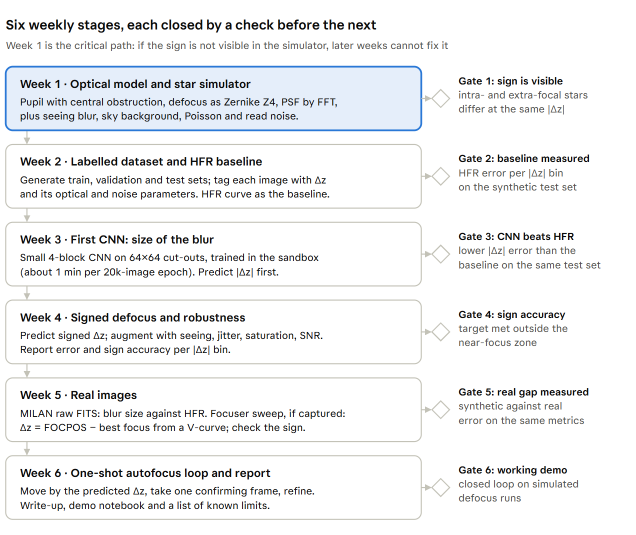

# Single-Image Telescope Autofocus — Problem Statement & Plan

Nov 18, 2026 · @Bernardo

> [!NOTE]
> **Repository note:** This plan was authored during [Phase 3 (`P-04`)](WORKFLOW_PROCEDURE.md#phase-3-problem-statement--plan) before building the simulator. An initial calibrated prototype matching Weeks 1–4 is now available in [`Fourier-optics simulator/`](Fourier-optics%20simulator/README_v1.md) (with the non-physical CPU benchmark placeholder in [`Benchmark v0/`](Benchmark%20v0/README.md)).

## Problem statement

From one image of a star, estimate the telescope's signed focus error: how far the focuser is from best focus, and in which direction. A CNN trained on synthetic star images does the estimate.

- **Input:** one grey star cut-out (64×64 pixels) taken from a single frame.
- **Output:** the signed defocus Δz. Its size says how far to move; its sign says whether the sensor is inside or outside focus.
- **Label:** every image is tagged with its Δz, defined as the focuser position minus the best-focus position:

$$
\Delta z = p - p^{*}
$$

Classical autofocus fits a V-curve to star size (HFR, half-flux radius) over a sweep of several frames. One frame gives the size of the blur but not its direction. A single-image estimate saves the sweep and can correct focus between science frames.

The core difficulty is the sign. Pure, symmetric defocus blurs a star the same way on both sides of focus, so the sign cannot be read from it. It becomes visible only when something breaks the symmetry: spherical aberration, the central obstruction of a reflector, or a deliberate astigmatism. The simulator must model that asymmetry, or the signed task is impossible.

## Data and labels

Training uses synthetic images only, because they are the one source where every image comes with an exact signed Δz. Real data is for testing. Each image is stored with its Δz plus the optical and noise parameters used to make it.

| Source                                                                     | Role                        | Focus label                                          | Status     |
| -------------------------------------------------------------------------- | --------------------------- | ---------------------------------------------------- | ---------- |
| Own simulator (pupil, defocus, obstruction, seeing, noise)                 | Train, validation, test     | Exact signed Δz                                     | To build   |
| Focuser sweep in FITS (own capture)                                        | Real test with labels       | Δz = FOCPOS header − best focus from a V-curve fit | To ask for |
| [MILAN Sky Survey](https://zenodo.org/records/7304607) (raw FITS, Stellina) | Real test, no labels        | Blur size only (HFR), no sign                        | Available  |
| [BBBC006](https://bbbc.broadinstitute.org/BBBC006) (microscopy z-stack)     | Optional parallel benchmark | Signed z: z = 16 in focus, 2 µm steps               | Available  |
| Kaggle: Mapping Dark Matter, Blur Dataset                                  | Reference only              | None                                                 | Not a fit  |

No Kaggle dataset found tags star images with a signed focus value. A focuser sweep captured with NINA, Ekos or ASCOM software would give the only real images with signed labels.

## Constraints

The work fits a CPU-only sandbox if star cut-outs stay at 64×64 (96×96 at most) and the network stays small. The course runs 6 weeks with 18 h of live sessions.

- **Sandbox:** 2 cores (Intel Xeon, 2.1 GHz, AVX-512 and AMX), 7.8 GB RAM, about 31 GB of free disk, no GPU, PyTorch 2.15 (CPU).
- **Measured speed** (4-block CNN, batch of 128): 64×64 runs at about 340 images/s, so one epoch of 20k images takes about 1 min. 128×128 runs at about 60 images/s, about 5.5 min per epoch.
- **Data generation:** 20k synthetic 64×64 stars in 7.5 s, using about 330 MB of memory.
- **Run length:** jobs left running in the background stop a few minutes after a reply, so each training run must finish within one working turn (about 10 min).

## Success criteria

The model succeeds if it beats the HFR baseline on blur size and gets the sign right away from the near-focus zone. Errors are reported per |Δz| bin, in units of the depth of focus, so results stay comparable across telescope settings.

| Metric                     | Measured on                                     | Target                          |
| -------------------------- | ----------------------------------------------- | ------------------------------- |
| Mean absolute error of Δz | Synthetic test set, per \|Δz\| bin              | To agree (beat HFR baseline)    |
| Sign accuracy              | Synthetic test set, outside the near-focus zone | To agree (proposal: ≥ 95%)     |
| Sign accuracy              | Real focuser sweep, if captured                 | Reported, no target set yet     |
| Blur size against HFR      | MILAN real frames                               | Reported as a correlation       |
| Moves to reach focus       | Simulated autofocus runs                        | To agree (proposal: 1–2 moves) |

Near best focus the sign matters little, because any move there is small. That zone is reported apart from the rest.

## Plan

The plan runs one stage per week, and each week ends on a check (a gate) that must pass before the next stage starts.

If a gate fails, apply its fallback from Risks before moving on. Week 1's gate decides whether the signed task is possible at all.

## Risks and open decisions

The biggest risk is that the modelled telescope shows no sign at all. That makes the choice of optics the first decision to take.

| Risk                                                                    | Effect                                | Fallback                                                                                                                    |
| ----------------------------------------------------------------------- | ------------------------------------- | --------------------------------------------------------------------------------------------------------------------------- |
| Optics too symmetric (e.g. an unobstructed refractor with pure defocus) | Sign cannot be learned                | Model a reflector with an obstruction, add a little astigmatism, or predict size only and probe the sign with one test move |
| Gap between simulation and real images                                  | Good synthetic scores, poor real ones | Randomize seeing, noise, sampling and background; test on MILAN and a focuser sweep                                         |
| No real images with labels                                              | Sign never checked on real data       | Ask the student or a local astronomy club for one focuser sweep                                                             |
| CPU-only sandbox                                                        | Slow or cut-off training              | 64×64 cut-outs, a small CNN, runs under about 10 min                                                                       |

To decide before week 1 ends:

- [ ] Which telescope to model: aperture, focal ratio, obstruction ratio, pixel scale
- [ ] Unit for Δz: focuser steps, µm at the focal plane, or waves of defocus
- [ ] Target values for error and sign accuracy
- [ ] Whether the student can capture a focuser sweep
